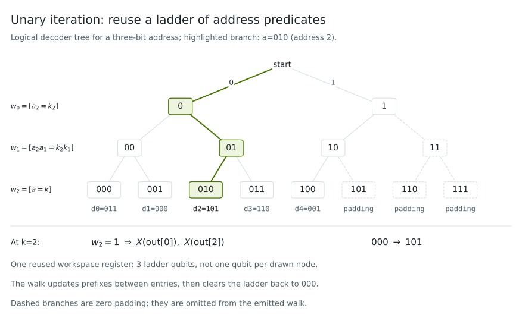

Coherent circuit primitives
===========================

These building blocks compose inside CUDA-Q kernels. The runnable examples
compare their complete outputs with independent classical references.

Coherent table lookup with QROM
-------------------------------

A classical table can be queried by a quantum address without measuring it.
For table entries :math:`d_a`, QROM implements the XOR lookup

.. math::

   |a\rangle |0\rangle_{\mathrm{ladder}} |y\rangle
   \longmapsto |a\rangle |0\rangle_{\mathrm{ladder}} |y\oplus d_a\rangle.

The output word need not start at zero. Addresses beyond the supplied table
read zero. A valid zero-valued entry has the same XOR action as padding,
although their meanings in the application differ.

.. code-block:: python

   from cudaq_algorithms.primitives import QROM

   table = QROM([3, 0, 5, 6, 1], address_bits=3, output_bits=3,
                variant="select")
   lookup = table.kernel  # callable property, not table.kernel()

Allocate the ladder using `table.num_ladder`. It must start clean and is
restored by the lookup. The constructor's validation rules and the exact
Toffoli model are in the API reference,
:class:`~cudaq_algorithms.primitives.QROM`. The plain callable has this
signature:

.. code-block:: text

   lookup(address: qview, ladder: qview, output: qview)

Lookup, use, unlookup
~~~~~~~~~~~~~~~~~~~~~

Load the word into a zero output, apply Z to its least-significant bit, then
apply the same lookup again. Each address amplitude gains
:math:`(-1)^{d_a \bmod 2}`, while output and ladder return to zero. The address
can remain entangled with the useful result; cleanup removes the table data,
not the selected action. Applying lookup twice without using the word is a
useful inverse check, but does not establish the correctness of the lookup.

SELECT and SELECT-SWAP
~~~~~~~~~~~~~~~~~~~~~~

`variant="select"` uses a unary-iteration walk. `variant="select_swap"` loads
blocks and routes a word using controlled swaps. SELECT-SWAP's ladder view
contains both walk lines and clean block storage. It can require substantially
more qubits, and can lose on small tables or wide output words.

`variant="auto"` minimizes the implemented coherent Toffoli model and chooses
SELECT on ties. It does not enforce a caller's qubit budget. Inspect
`variant`, `block_size`, `num_ladder`, and `toffoli_count` on the returned
object. `variant="select_swap"` picks the cheapest power-of-two block size
unless `block_size` is given; the example forces `block_size=2`.

In the SELECT construction, unary iteration reuses one clean ladder qubit
per address bit. Successive lines track progressively longer prefix matches;
the final line enables the output gates for that table entry.

         reused ladder lines enable output flips for table entry 2;
         dashed branches indicate omitted zero-padding addresses.
   :width: 100%
   :align: center

   Unary iteration for the five-entry table above. The highlighted basis
   component ``a=010`` selects ``DATA[2]=5`` (binary ``101``), flipping
   output bits zero and two. Nodes depict logical checks at different times,
   rather than separate physical ancillas: only three ladder qubits are reused and
   restored to zero. The valid zero-valued entry at address one remains
   distinct from padded addresses five through seven, which the emitted
   walk omits. Superposed addresses follow the same lookup coherently.

External control
~~~~~~~~~~~~~~~~

`controlled=True` creates a separately priced native-controlled lookup:

.. code-block:: text

   controlled_lookup(control: qview, address: qview,
                     ladder: qview, output: qview)

The control is a one-qubit view. On clean ladder input, control zero gives
identity and control one gives the ordinary lookup. Superposed controls must
preserve both branches and their relative phase. Read this object's own
`num_ladder`; native control can change the auto-selected geometry.

Wrapping a plain lookup with `cudaq.control` instead controls every emitted
gate. In particular, a Toffoli can become a three-controlled X. Comparing
only the remaining Toffolis would hide that extra cost. The example counts
two-controlled and higher-controlled X separately and checks the native
price against `cudaq.estimate_resources`. `count_controls("x", 2)` is the
Toffoli accessor; `count("ccx")` is not.

All constructions here use coherent cleanup. These logical gate counts are
not synthesized T counts and do not assume measurement-based erasure.

See :doc:`../examples_rst/primitives` for executable complex-amplitude and
workspace checks, including a resource-only strategy crossover table.

Modular arithmetic and comparison flags
---------------------------------------

These primitives support two approaches to reversible arithmetic: **CDKM
ripple-carry arithmetic** and **QFT arithmetic**. Both operate coherently on
superpositions, so each integer component undergoes the corresponding
arithmetic operation without measurement.

**CDKM**, named after Cuccaro, Draper, Kutin, and Moulton, follows the familiar
idea of binary addition: carries propagate from lower bits to higher bits.
The circuit then reverses its temporary carry computations while retaining
the sum. It uses X, CNOT, and Toffoli gates, with a gate count that grows
linearly with register width. CDKM is a useful choice for arithmetic on
binary-encoded registers and for resource estimates organized around Clifford
and Toffoli gates. See `Cuccaro et al.
<https://arxiv.org/abs/quant-ph/0410184>`_.

**QFT arithmetic** uses the quantum Fourier transform to represent an integer
through quantum phases. Adding a constant becomes a sequence of phase
rotations; an inverse QFT converts the result back to binary form. This
avoids temporary carry registers. QFT arithmetic is particularly useful when
spare qubits are limited, when a register is already in the Fourier basis,
or when several additions can share one forward and inverse transform.
See `Draper <https://arxiv.org/abs/quant-ph/0008033>`_.

For the constant-addition implementations provided here, an :math:`n`-qubit
target requires an additional :math:`n`-qubit work register and one carry
qubit with CDKM, while the QFT implementation needs no additional qubits.
The tradeoff is gate cost: QFT arithmetic introduces controlled phase
rotations, including small-angle rotations whose accurate synthesis can be
expensive on fault-tolerant hardware. **Choose CDKM when its workspace
requirements are acceptable and avoiding rotation synthesis is valuable;
consider QFT when reducing qubits or reusing the Fourier basis is more
valuable.** Compare the complete circuit cost, including transforms and
rotation synthesis, rather than Toffoli count alone. Both implement the same
modular arithmetic in the ideal circuit model.

All integer registers are unsigned and little-endian: bit zero has weight
one. Addition wraps modulo :math:`2^n`. Register views passed to an operation
must be pairwise disjoint and have the documented widths; the device kernels
do not check aliasing or validate inputs at runtime.

Import these kernels from `cudaq_algorithms.primitives`. Their signatures
are rendered explicitly here because automatic API documentation does not
render decorated CUDA-Q kernels. See :doc:`../api/arithmetic` for the
indexed reference, including Fourier transforms and Fourier-basis addition.

Register and constant arithmetic
~~~~~~~~~~~~~~~~~~~~~~~~~~~~~~~~

The ripple-carry CDKM family restores its work and carry registers:

.. code-block:: text

   add_register(a: qview, b: qview, carry: qview)
   subtract_register(a: qview, b: qview, carry: qview)
   add_constant(target: qview, constant_bits: list[int],
                work: qview, carry: qview)
   subtract_constant(target: qview, constant_bits: list[int],
                     work: qview, carry: qview)

`a` and `b` have width n. Addition preserves a and maps b to
`(a+b) mod 2**n`; subtraction maps b to `(b-a) mod 2**n`.
The carry is a one-qubit view initially in zero. Constant arithmetic takes
exactly n little-endian bits for the constant K, an n-qubit clean work
register, and a clean one-qubit carry. For example, adding three to a three-bit seven gives
two, with all workspace restored.

The QFT family takes an integer constant and needs no additional workspace:

.. code-block:: text

   add_constant_qft(reg: qview, constant: int)
   subtract_constant_qft(reg: qview, constant: int)

Both families implement the same modular permutation. Use the supplied
inverse kernels for round trips: every inverse is hand-written, and
`cudaq.adjoint` is not supported on the CDKM kernels. The example also tests
each forward action independently: two incorrect operations can cancel in a
round trip.

Comparison flags are XOR outputs
~~~~~~~~~~~~~~~~~~~~~~~~~~~~~~~~~

.. code-block:: text

   cmp_ge_register(a: qview, b: qview, carry: qview, out: qview)
   cmp_gt_register(a: qview, b: qview, carry: qview, out: qview)
   cmp_ge_constant(x_reg: qview, complement_bits: list[int],
                   k_is_zero: int, work: qview, carry: qview, out: qview)

`out` is a one-qubit view and obeys `out ^= predicate`. It is not overwritten
with a classical Boolean. Preloaded-one and coherent flags are valid. The
register comparators preserve both n-bit operands and restore their clean
carry; `cmp_gt_register` flags the strict `a > b` at the same price.

For the constant comparator, pass the n low bits of `2**n-K`,
least-significant bit first: for n=3 and K=2 the value is 6 and the list is
`[0, 1, 1]`. The allowed threshold range is `0 <= K <= 2**n`. At K=0 pass
all-zero bits and `k_is_zero=1`, producing an always-true predicate. At
`K=2**n` pass all-zero bits and `k_is_zero=0`, producing always false. An
n-qubit work register and one-qubit carry start and finish at zero.

A useful coherent pattern is compute/use/uncompute: start a flag at zero,
compute `x >= K` into it, apply Z to the flag, and repeat the comparator.
The operand acquires :math:`(-1)^{[x\ge K]}`, while the flag and workspace
return to zero. This is a building block for threshold selection and
boundary masking.

For example, let the operand be ``(|2> + |5>)/sqrt(2)`` and use threshold
K=3. Only the branch with x=5 satisfies the comparison. With kets ordered
as operand then flag, the circuit evolves as

.. math::

   \begin{aligned}
   \text{Input:}\quad & (|2\rangle|0\rangle + |5\rangle|0\rangle)/\sqrt{2},\\
   \text{Compare }x\ge3:\quad & (|2\rangle|0\rangle + |5\rangle|1\rangle)/\sqrt{2},\\
   Z\text{ on flag:}\quad & (|2\rangle|0\rangle - |5\rangle|1\rangle)/\sqrt{2},\\
   \text{Uncompute:}\quad & (|2\rangle|0\rangle - |5\rangle|0\rangle)/\sqrt{2}.
   \end{aligned}

The values retain probability one half each, while their relative phase
changes. Interference can reveal that change: the final operand state is
orthogonal to its initial state. The flag and all work/carry qubits return
to zero, so this threshold oracle can compose with subsequent operations.
The runnable example prints these four states from separate simulator
runs of circuit prefixes and verifies every full state against an
independent reference; no measurement is inserted into the oracle.

The QFT comparator temporarily shifts its operand
~~~~~~~~~~~~~~~~~~~~~~~~~~~~~~~~~~~~~~~~~~~~~~~~~~

.. code-block:: text

   cmp_ge_constant_qft_shift(x_reg: qview, constant: int,
                            invert: int, out: qview)
   cmp_ge_constant_qft_shift_adj(x_reg: qview, constant: int,
                                invert: int, out: qview)

At `invert=0` it XORs `x >= K` into out and leaves x at
`(x-K) mod 2**n` for positive K. At `invert=1` it flags `x < K`.
The allowed threshold range is again `0 <= K <= 2**n`; K=0 leaves x
unshifted. The implementation supports n <= 61.

Use only the flag between compute and its supplied adjoint. The adjoint
restores both operand and flag after a phase mark. Treating this compute
half as an operand-preserving comparator would consume the wrong integer.

Resources and correctness
~~~~~~~~~~~~~~~~~~~~~~~~~

In the current implementation, CDKM modular add/subtract uses `2*n-2`
Toffolis, while register comparison uses `2*n-1`. QFT constant addition
uses controlled and single-qubit rotations instead. Zero Toffolis does not
mean zero fault-tolerant synthesis cost.

The :ref:`reversible modular arithmetic example
<examples_rst/primitives:Reversible modular arithmetic>` uses nonuniform
complex superpositions, explicit overflow inputs, logical permutation
references, and complete-state cleanup checks. Its resource-only width sweep
excludes input-state preparation and reports rotations separately from
Toffolis.
