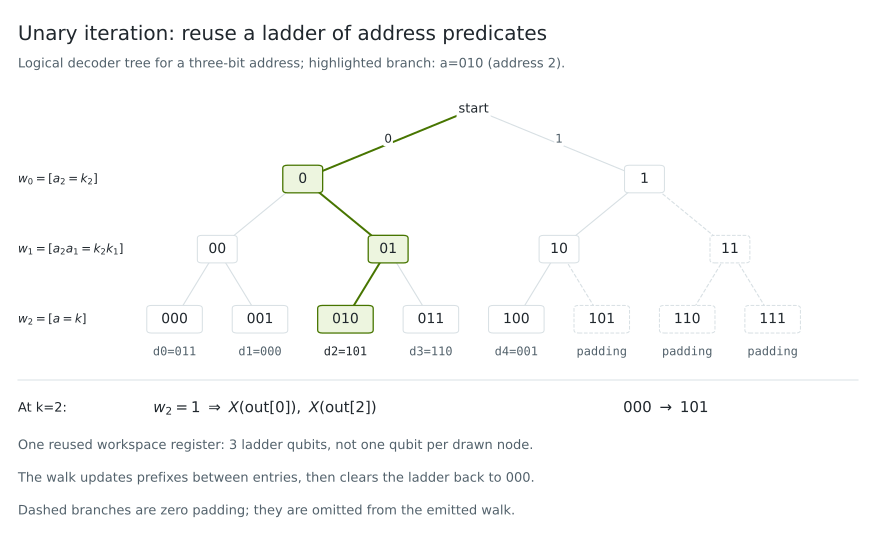

Coherent circuit primitives
===========================

These building blocks compose inside CUDA-Q kernels. The runnable examples
compare their complete outputs with independent classical references.

Coherent table lookup with QROM
-------------------------------

A classical table can be queried by a quantum address without measuring it.
For table entries :math:`d_a`, QROM implements the XOR lookup

.. math::

   |a\rangle |0\rangle_{\mathrm{ladder}} |y\rangle
   \longmapsto |a\rangle |0\rangle_{\mathrm{ladder}} |y\oplus d_a\rangle.

The output word need not start at zero. Addresses beyond the supplied table
read zero. A valid zero-valued entry has the same XOR action as padding,
although their meanings in the application differ.

.. code-block:: python

   from cudaq_algorithms.primitives import QROM

   table = QROM([3, 0, 5, 6, 1], address_bits=3, output_bits=3,
                variant="select")
   lookup = table.kernel  # callable property, not table.kernel()

Allocate the ladder using `table.num_ladder`. It must start clean and is
restored by the lookup. The constructor's validation rules and the exact
Toffoli model are in the API reference,
:class:`~cudaq_algorithms.primitives.QROM`. The plain callable has this
signature:

.. code-block:: text

   lookup(address: qview, ladder: qview, output: qview)

Lookup, use, unlookup
~~~~~~~~~~~~~~~~~~~~~

Load the word into a zero output, apply Z to its least-significant bit, then
apply the same lookup again. Each address amplitude gains
:math:`(-1)^{d_a \bmod 2}`, while output and ladder return to zero. The address
can remain entangled with the useful result; cleanup removes the table data,
not the selected action. Applying lookup twice without using the word is a
useful inverse check, but does not establish the correctness of the lookup.

SELECT and SELECT-SWAP
~~~~~~~~~~~~~~~~~~~~~~

`variant="select"` uses a unary-iteration walk. `variant="select_swap"` loads
blocks and routes a word using controlled swaps. SELECT-SWAP's ladder view
contains both walk lines and clean block storage. It can require substantially
more qubits, and can lose on small tables or wide output words.

`variant="auto"` minimizes the implemented coherent Toffoli model and chooses
SELECT on ties. It does not enforce a caller's qubit budget. Inspect
`variant`, `block_size`, `num_ladder`, and `toffoli_count` on the returned
object. `variant="select_swap"` picks the cheapest power-of-two block size
unless `block_size` is given; the example forces `block_size=2`.

In the SELECT construction, unary iteration reuses one clean ladder qubit
per address bit. Successive lines track progressively longer prefix matches;
the final line enables the output gates for that table entry.

         reused ladder lines enable output flips for table entry 2;
         dashed branches indicate omitted zero-padding addresses.
   :width: 100%
   :align: center

   Unary iteration for the five-entry table above. The highlighted basis
   component ``a=010`` selects ``DATA[2]=5`` (binary ``101``), flipping
   output bits zero and two. Nodes depict logical checks at different times,
   rather than separate physical ancillas: only three ladder qubits are reused and
   restored to zero. The valid zero-valued entry at address one remains
   distinct from padded addresses five through seven, which the emitted
   walk omits. Superposed addresses follow the same lookup coherently.

External control
~~~~~~~~~~~~~~~~

`controlled=True` creates a separately priced native-controlled lookup:

.. code-block:: text

   controlled_lookup(control: qview, address: qview,
                     ladder: qview, output: qview)

The control is a one-qubit view. On clean ladder input, control zero gives
identity and control one gives the ordinary lookup. Superposed controls must
preserve both branches and their relative phase. Read this object's own
`num_ladder`; native control can change the auto-selected geometry.

Wrapping a plain lookup with `cudaq.control` instead controls every emitted
gate. In particular, a Toffoli can become a three-controlled X. Comparing
only the remaining Toffolis would hide that extra cost. The example counts
two-controlled and higher-controlled X separately and checks the native
price against `cudaq.estimate_resources`. `count_controls("x", 2)` is the
Toffoli accessor; `count("ccx")` is not.

All constructions here use coherent cleanup. These logical gate counts are
not synthesized T counts and do not assume measurement-based erasure.

See :doc:`../examples_rst/primitives` for executable complex-amplitude and
workspace checks, including a resource-only strategy crossover table.
